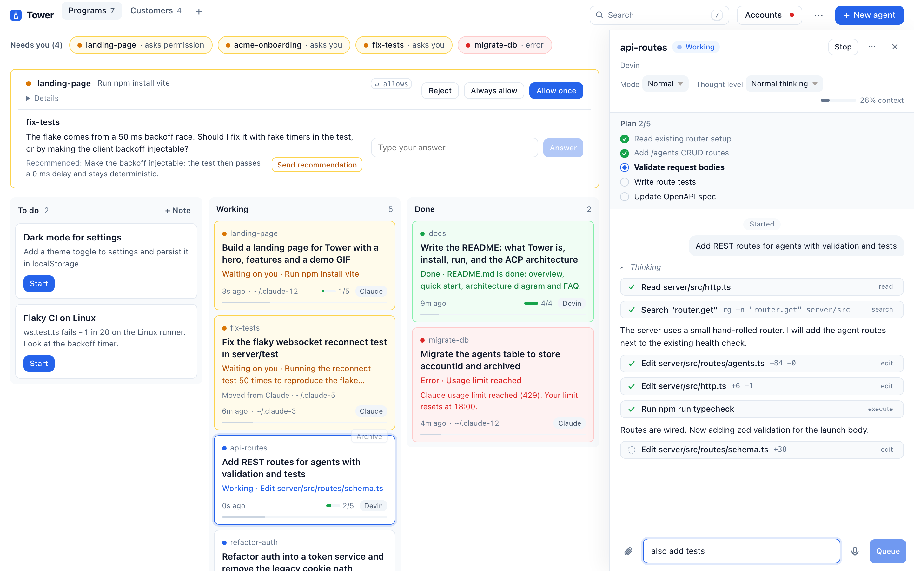
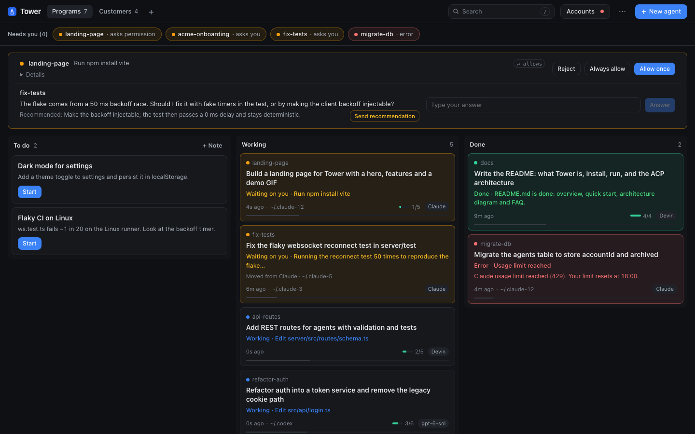
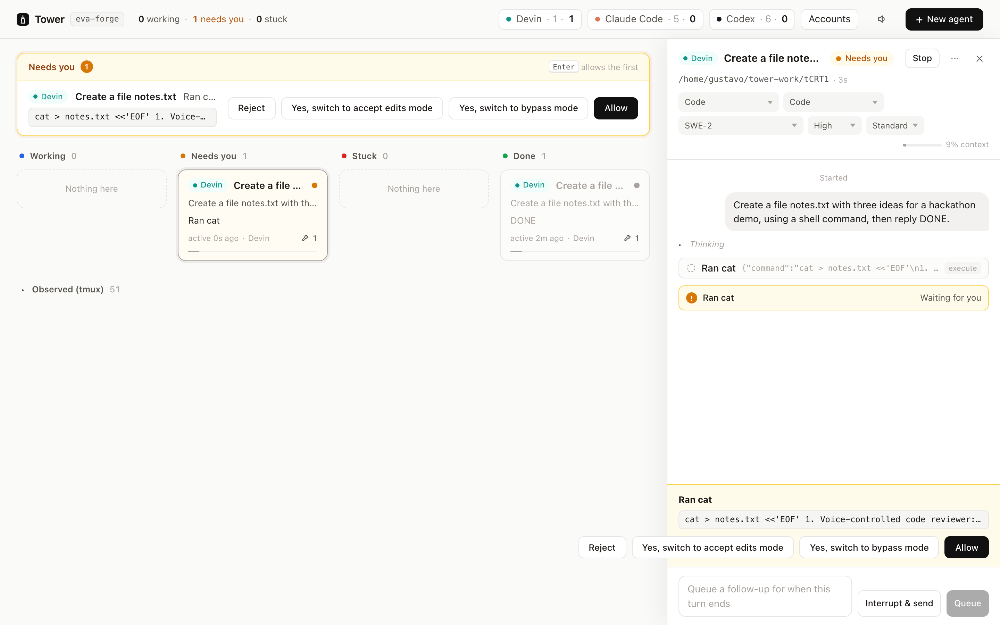

# Tower

**One control tower for every coding agent.** Launch and supervise Devin, Claude Code and Codex side by side on
your own server, through the open [Agent Client Protocol](https://agentclientprotocol.com): live cards per agent,
one "Needs you" inbox for every permission request, stuck detection, and per-agent capacity — on desktop or phone.

Built in one afternoon at the **Devin AI Hackathon @ Georgia Tech** (2026-10-24), entirely with Devin.

## Why

I run a company with one human and about forty AI coding agents on a 96-core server. The question I ask all day is
"which agent needs me right now?" — and every vendor's dashboard only shows its own agents. My previous board
(Forja, private) watched agents by scraping their terminals with regular expressions. Tower drops the scraping:
every agent speaks ACP, so Tower receives real, structured events — messages, tool calls, plans and permission
requests — from Devin, Claude Code and Codex in the same shape.

Tower complements Devin Cloud rather than replacing it: Devin Cloud runs Devin on managed machines; Tower is the
board above every agent on your own machine — your repos, your secrets, the subscriptions you already have.

## What it does

- **Launch any agent** (Devin, Claude Code, Codex) with a task; each works in its own folder under `~/tower-work/`.
- **Live board**: Working · Needs you · Stuck · Done, with the agent's last words, tool-call count and plan progress.
- **Needs you inbox**: every permission request from every agent in one list; Allow / Reject in one tap.
- **Agent panel**: the live feed (messages, thoughts, tool calls, plan) and a composer to keep talking to the agent.
- **Stuck detection**: a working agent that goes silent past a threshold turns red.
- **Capacity chips**: which agent kinds are installed, logged in and running.
- **Observed sessions**: existing tmux agent sessions on the host appear as read-only cards (redacted by default);
  opt-in, allow-listed sessions become interactive (live screen, send text and keys, confirmation per card).
- **Talk any time**: messages typed while an agent works are queued and sent when its turn ends; "Interrupt & send"
  cancels the turn first. Mode, model and effort switch live over ACP; a context bar shows how full the window is.
- **Rich conversation**: Markdown replies, expandable tool output, `/` command menu, attachments (drag, paste,
  paperclip) and dictation.
- **Questions from agents**: `tower ask "…"` (a tiny CLI on a private unix socket) puts a question with a recommended
  answer in the inbox; the answer returns to the agent as its next message.
- **Sessions talking to each other**: `tower send --to <agent> "…"` and `tower handoff "task"`, which opens a linked
  session and delivers its result back to the requester; boards for programs and customer-dedicated sessions.
- **Multiple subscriptions + rotation**: discovers every Claude/Codex config home, shows plan, login state, usage and
  reset countdowns; launches on a chosen account or "Automatic"; when an account hits its limit, auto-rotate moves the
  agent to the next available account and logs it ([comparison with my earlier tool](docs/subswitch-vs-tower.md)).
- **Survives restarts**: cards, feeds, notes and rotation state persist; Resume reloads a session over ACP.
- **Organize**: notes that start agents, archive, search, J/K navigation, drag and drop, light and dark themes,
  attention alerts and notifications (HTTPS inside the tailnet).

## Screenshots

| Board with the Needs-you strip (light) | Dark |
|---|---|
|  |  |

Live on the real server — a Devin agent asking to run a shell command, approved from the inbox:



(Headless Playwright captures: `web/verify/*.mjs` in mock mode and `verify-live*.mjs` against the live server.
Existing tmux sessions are shown redacted.)

## Architecture

```
 phone / laptop ──Tailscale + token──▶  Tower server (Node, TypeScript)  ──stdio ACP──▶  devin acp
                     HTTP + WebSocket   agent manager · inbox · stuck    ──stdio ACP──▶  claude-agent-acp
                                        capacity · tmux discovery        ──stdio ACP──▶  codex-acp
```

- `shared/contract.ts` — the single contract between server and web (types, routes, events).
- `server/` — ACP client per agent, in-memory state, HTTP API, WebSocket broadcast, static web.
- `web/` — Vite + React board (plain CSS), with a `?mock=1` mode.
- `ops/` — systemd user unit and deploy script.

## Run

```bash
npm install && npm --prefix server install && npm --prefix web install
npm run build                         # builds web/dist
TOWER_TOKEN=$(openssl rand -hex 16) TOWER_HOST=127.0.0.1 npm start
open "http://127.0.0.1:4747/?token=$TOWER_TOKEN"
```

Environment: `TOWER_TOKEN` (required), `TOWER_HOST` (default `127.0.0.1`), `TOWER_PORT` (default `4747`),
`TOWER_WORK_DIR` (default `~/tower-work`), `TOWER_STUCK_MS` (default `300000`).

## Security

Tower can run coding agents on the machine it lives on, so it binds to loopback or a private (Tailscale) address,
requires a bearer token on every request and the WebSocket, and confines each agent's file reads and writes to its
own work folder. Agents are spawned without any `TOWER_*` variable in their environment. Known limitation: agents
run as the same OS user as Tower, so a determined agent could read Tower's env file; run Tower under its own user
for stronger isolation. Never expose it to the public internet.

## Agent notes (from real ACP probes)

| Agent | Launch | Asks permission when |
|---|---|---|
| Devin | `devin acp` | mode `accept-edits` (default): shell commands ask, file edits are auto-approved |
| Claude Code | `claude-agent-acp` | session created in mode `default` with skip-permissions disabled |
| Codex | `codex-acp` | mode `read-only`: asks before running commands |

## Multiple subscriptions

People who pay for several Claude or Codex subscriptions keep one config home per account (`~/.claude-N`,
`~/.codex-N`). Tower discovers them, shows each account's plan, login state and running agents in the Accounts panel
(with the exact login command for any account that is logged out), and lets you launch an agent on a specific
account or on "Automatic", the logged-in account with the most headroom.

## Roadmap

- True Web Push when the browser is closed (VAPID); today notifications work while the app is open or backgrounded.
- Routines (scheduled persistent sessions) and sign-in with Google through Cloudflare Access.
- Per-agent socket credentials so one agent can never ask or send as another.

## How it was built

Everything in this repository was written on 2026-10-24 during the hackathon, by Devin: a lead Devin session wrote
the contract and plan, then three Devin workers built the server, the web board and the host setup in parallel,
followed by a Devin code review and headless browser verification. Forja (my earlier private board) was the
inspiration only; no code was copied from it.
